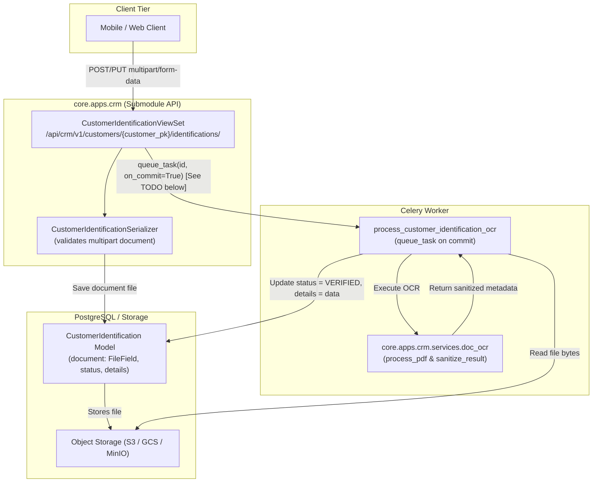

# Document OCR Service & Core Migration Plan

> **Status:** Temporarily residing in `backend/overrides/services/` until core migration is completed.
> **Service Implementation:** [`doc_ocr.py`](./doc_ocr.py)

---

## 1. Overview & Temporary Context

The document scanning and OCR service in this directory was initially authored inside the host project's `overrides` app without awareness of the `core-common-django-apps` submodule.

To keep the host project clean, stable, and conforming to project standards:
- All shadow models (`UploadedDocument`), rogue storage classes, and duplicate API endpoints have been purged from `overrides`.
- The standalone OCR processing engine ([`doc_ocr.py`](./doc_ocr.py)) is temporarily retained here because it is decoupled from database models.
- A placeholder task exists in [`backend/overrides/tasks.py`](../tasks.py) to avoid broken Celery autodiscovery.
- This document outlines the technical architecture of the OCR engine and the roadmap to migrate it into `core-common-django-apps`.

---

## 2. OCR Engine Capabilities (`doc_ocr.py`)

The OCR service extracts, classifies, and validates Indian regulatory and vehicle identification documents from PDF files using `pymupdf`, `pytesseract`, and `Pillow`.

### Supported Document Types & Extracted Fields

| Document Type | Identifier (`type`) | Key Extracted Fields | Validation & Sanitization |
|---|---|---|---|
| **Aadhaar Card** | `aadhaar` | `aadhaar_number`, `name`, `gender`, `dob`, `year_of_birth` | Verhoeff checksum validation; masks all but last 4 digits |
| **Driving License** | `driving_license` | `license_number`, `name`, `guardian_name`, `dob`, `valid_upto`, `vehicle_classes`, `address`, `pin_code` | State code + format regex; masks intermediate digits |
| **Registration Certificate (RC)** | `registration_certificate` | `registration_number`, `chassis_number`, `engine_number`, `owner_name`, `vehicle_class`, `fuel_type`, `maker_model`, `registration_date` | Vehicle format regex (standard + BH series); masks chassis/engine tail |
| **PUC Certificate** | `puc` | `certificate_number`, `registration_number`, `valid_upto`, `emission_norms`, `fuel_type`, `test_date` | Dates normalized to ISO 8601 (`YYYY-MM-DD`) |
| **Vehicle Insurance** | `insurance` | `policy_number`, `insurer_name`, `registration_number`, `insured_name`, `valid_from`, `valid_upto` | Policy number extraction; date range validation |

### Service Methods & Interfaces

- `validate_pdf(file_bytes: bytes) -> None`:
  - Validates file header and structure via PyMuPDF.
  - Ensures document is unencrypted.
  - Restricts page count to a maximum of 10 pages and file size to 10 MB.
  - Raises `InvalidDocumentError` on validation failure.
- `classify(text: str) -> str`:
  - Keyword frequency matching against compiled heuristics to auto-detect document type if not specified by caller.
- `process_pdf(file_bytes: bytes, doc_type: str | None = None) -> dict[str, Any]`:
  - Renders PDF pages to images (300 DPI) and runs OCR across English (`eng`) and Hindi (`hin`) language sets.
  - Returns classification confidence, detected document type, and raw/extracted dictionary.
- `sanitize_result(result: dict[str, Any]) -> dict[str, Any]`:
  - Strips PII and returns standardized structure:
    ```json
    {
      "document_type": "driving_license",
      "confidence": 0.95,
      "data": {
        "license_number": "DL-XXXXXXX1234",
        "name": "Jane Doe",
        "valid_upto": "2030-05-15",
        "vehicle_classes": ["LMV", "MCWG"]
      }
    }
    ```

---

## 3. Core Migration Target Architecture

In the unified framework, customer identification documents belong to `core.apps.crm`.



> [!NOTE]
> **TODO (Celery Beat Cron Migration)**: This OCR task should NOT remain a manually queued trigger (`queue_task`) invoked directly from the viewset/request cycle. Once Celery Beat is implemented in the deployment environment, pending document verification tasks will be processed periodically by Celery Beat on a configured cron schedule (scanning unverified `CustomerIdentification` records) instead of code manually queuing tasks per upload.

### 1. Model Binding: `CustomerIdentification`
In `core.apps.crm.models_abstract.customer_identification`, `AbstractCustomerIdentification` already contains:
- `customer`: FK to `CRM_CUSTOMER_MODEL`.
- `type`: `IdentityTypeChoices` (`aadhaar`, `driving_license`, `passport`, `pan`, `voter_id`, etc.).
- `document`: `models.FileField(upload_to=DOCUMENT_UPLOAD_PATH)`.
- `status`: `IdentityStatusChoices` (`unverified`, `pending`, `verified`, `rejected`).
- `is_verified`: Boolean flag.
- `verified_on`: Date field.
- `content_type` / `object_id` (`attribute`): GFK to specific regulatory detail models (e.g. Aadhaar details, DL details).

### 2. ViewSet & Serializer Enhancements
- Mount `MultiPartParser` and `FormParser` on `CustomerIdentificationViewSet` to support direct file uploads.
- Enhance `CustomerIdentificationSerializer` to run `validate_pdf` on incoming `document` uploads.
- **TODO (Celery Beat Cron Migration)**: While `queue_task(..., on_commit=True)` can serve as an interim trigger, the target pattern is for Celery Beat to run a scheduled cron job (e.g. `process_unverified_identifications_cron`) at a configured interval. The viewset simply saves the uploaded document with status `PENDING`/`UNVERIFIED`, and Beat picks it up without manual dispatching.

### 3. Background Task Execution
- Move `doc_ocr.py` to `core/apps/crm/services/doc_ocr.py`.
- Implement Celery task `core/apps/crm/tasks.py::process_customer_identification_ocr(identification_id: str)`:
  1. Retrieve `CustomerIdentification` instance.
  2. Read document bytes from `identification.document`.
  3. Run `process_pdf(pdf_bytes, doc_type=identification.type)`.
  4. Sanitize results and verify extracted identification number matches record expectations.
  5. Update `status = IdentityStatusChoices.VERIFIED.value`, `is_verified = True`, `verified_on = now().date()`, and attach extracted data to `details` or the linked GFK `attribute`.

---

## 4. Step-by-Step Execution Plan

### Phase A: `core-common-django-apps` Submodule PR
1. **Dependencies**: Add `pymupdf`, `pytesseract`, and `pillow` to `core-common-django-apps/pyproject.toml`.
2. **Move Engine**: Relocate `doc_ocr.py` into `core/apps/crm/services/doc_ocr.py`.
3. **Register Task**: Implement `process_customer_identification_ocr` in `core/apps/crm/tasks.py`.
4. **Update Serializer & ViewSet**: Enable multipart parser and PDF validation on `CustomerIdentificationViewSet` and `CustomerIdentificationSerializer`.
5. **Add Tests**: Add unit tests in `core/tests/crm/` covering document upload, OCR mock parsing, and task state updates.

### Phase B: `ride-share-app-django` Host Project PR
1. **Remove Temporary Stubs**: Delete `backend/overrides/services/` and `backend/overrides/tasks.py`.
2. **Bump Submodule**: Point `backend/core-common-django-apps` to the merged commit from Phase A.
3. **Verify Host**: Run `make t` and `pre-commit run --all-files` to confirm clean integration.
