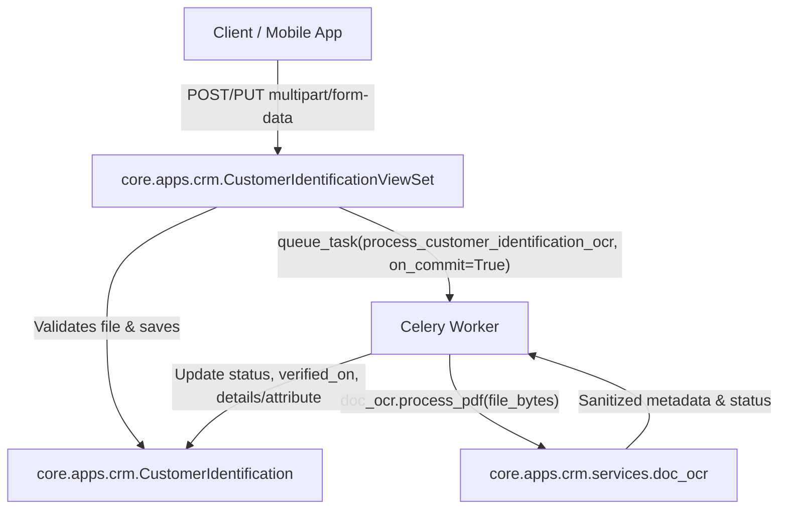

# Core Migration Plan: Document OCR Service

> For implementation details of the OCR parsing engine, see [backend/overrides/services/README.md](../backend/overrides/services/README.md) and [`backend/overrides/services/doc_ocr.py`](../backend/overrides/services/doc_ocr.py).

---

## Executive Summary

The OCR scanning service temporarily located in `backend/overrides/services/` will be migrated to the core framework (`core-common-django-apps`). The previous agent implemented shadow models (`UploadedDocument`) in the host project, which bypassed the core CRM KYC data model.

This document describes the architectural alignment and step-by-step migration plan.

---

## Architectural Mapping

| Capability | Rogue Override Implementation (Purged) | Proper Core Architecture (`core-common-django-apps`) |
|---|---|---|
| **API Endpoint** | `/api/overrides/v1/document-uploads/` | `/api/crm/v1/customers/{customer_pk}/identifications/` |
| **Model** | `overrides.models.UploadedDocument` | `core.apps.crm.CustomerIdentification` |
| **Document Storage** | `overrides.storage.PrivateDocumentStorage` | Standard Django storage / Object Storage via `CustomerIdentification.document` |
| **Document Type Enum** | `overrides.models.DocumentType` | `core.apps.crm.constants.IdentityTypeChoices` |
| **Status Enum** | `overrides.models.DocumentProcessingStatus` | `core.apps.crm.constants.IdentityStatusChoices` |
| **OCR Processing** | `overrides.tasks.process_uploaded_document` | `core.apps.crm.tasks.process_customer_identification_ocr` |
| **Extracted Data Store** | `UploadedDocument.result` (JSONField) | `CustomerIdentification.details` / GFK `attribute` |

---

## Workflow Diagram

---

## Execution Checklist

### 1. In `core-common-django-apps` Submodule
- [ ] Add OCR libraries (`pymupdf`, `pytesseract`, `pillow`) to `pyproject.toml`.
- [ ] Move `doc_ocr.py` to `core/apps/crm/services/doc_ocr.py`.
- [ ] Implement `process_customer_identification_ocr` Celery task in `core/apps/crm/tasks.py`.
- [ ] Add `MultiPartParser` and file validation to `CustomerIdentificationViewSet` and `CustomerIdentificationSerializer`.
- [ ] Author comprehensive pytest coverage in `core/tests/crm/`.

### 2. In `ride-share-app-django` Host Repository
- [ ] Delete temporary `backend/overrides/services/` and `backend/overrides/tasks.py`.
- [ ] Bump `backend/core-common-django-apps` submodule reference to the merged core commit.
- [ ] Run `make t` and `pre-commit run --all-files` to verify cleanly passing test suites.
