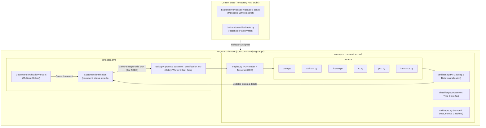

# OCR Service Refactor & Core Migration Roadmap

> **Target Repository:** `core-common-django-apps` (Submodule) & `ride-share-app-django` (Host)
> **Source Service:** [`backend/overrides/services/doc_ocr.py`](../../backend/overrides/services/doc_ocr.py)
> **Target Submodule App:** `core.apps.crm`

---

## 1. Executive Summary & Objective

The document scanning and OCR service currently resides temporarily in `backend/overrides/services/doc_ocr.py` within the host project. It is a monolithic 600-line script that bundles PDF rendering, Tesseract OCR invocation, document classification, heuristic regex parsing, Verhoeff checksum validation, and PII masking.

This roadmap details how to:
1. **Clean & Refactor** the OCR service into a modular, testable parser architecture.
2. **Move** the engine into the `core-common-django-apps` submodule under `core.apps.crm`.
3. **Wire** OCR extraction directly into `CustomerIdentification` and its Celery task pipeline via `queue_task()`.
4. **Purge** all temporary stubs from the host project once core is updated.

---

## 2. Current Architecture vs. Target Architecture



> [!NOTE]
> **TODO (Celery Beat Cron Migration)**: This OCR task should NOT remain a manually queued trigger (`queue_task`) invoked on each upload. Once Celery Beat is implemented, document scanning tasks will be executed by Beat on a configured cron schedule (querying records where `status=IdentityStatusChoices.PENDING` or `UNVERIFIED`) instead of code manually queuing tasks per upload.

---

## 3. Modular Refactoring of the OCR Engine

Instead of maintaining a 600-line monolithic file, the engine will be decomposed into a modular package in `backend/core-common-django-apps/core/apps/crm/services/ocr/`:

### 3.1 Directory Layout in Core
```text
core/apps/crm/services/ocr/
├── __init__.py                # Public entry points: process_document(), validate_document()
├── engine.py                  # PyMuPDF rendering, Tesseract execution, image preprocessing
├── classifier.py              # Heuristic keyword-weight classification
├── validators.py              # Verhoeff checksum algorithm, date parsers, vehicle regexes
├── sanitizer.py               # PII masking (Aadhaar last 4, DL mid-digits, chassis tail)
└── parsers/
    ├── __init__.py            # Parser registry
    ├── base.py                # BaseDocumentParser abstract base class
    ├── aadhaar.py             # AadhaarParser (UIDAI formatting, name extraction)
    ├── license.py             # DrivingLicenseParser (state codes, vehicle classes, dates)
    ├── rc.py                  # RegistrationCertificateParser (standard + BH series)
    ├── puc.py                 # PUCCertificateParser (emission norms, dates)
    └── insurance.py           # InsuranceParser (policy number, insurer name, validity)
```

### 3.2 Key Design Patterns
- **BaseDocumentParser**: Defines `parse(raw_text: str) -> dict[str, Any]` and `validate(data: dict[str, Any]) -> bool`.
- **Parser Registry**: Maps `IdentityTypeChoices` to dedicated parser classes. Extensible for future document types (e.g. PAN, Voter ID, Passport) without touching existing parsers.
- **Pure Functions**: Image conversion and text extraction are decoupled from Django ORM models for fast, deterministic unit testing with mock bytes.

---

## 4. Phase-by-Phase Execution Roadmap

### Phase 1: Dependency & Environment Preparation (Core Submodule)
- [x] Extra dependencies already configured in `backend/core-common-django-apps/pyproject.toml` under `[project.optional-dependencies] ocr`:
  - `pillow (>=13.0.0,<14.0.0)`
  - `pymupdf (>=2.1,<3.0)`
  - `pytesseract (>=0.3.13,<0.4.0)`
- [ ] Ensure Docker local backend image installs `tesseract-ocr`, `tesseract-ocr-eng`, and `tesseract-ocr-hin` (already verified in host Dockerfile).

### Phase 2: Refactor & Implement OCR Engine in Core
- [ ] Create `core/apps/crm/services/ocr/` and modularize the codebase:
  - Migrate `validators.py`: Verhoeff checksum, Indian vehicle number formats, date normalizers.
  - Migrate `engine.py`: PDF validation (header, size, page limits, unencrypted check) and rendering.
  - Migrate `parsers/`: Document-specific parsers (`aadhaar`, `license`, `rc`, `puc`, `insurance`).
  - Migrate `sanitizer.py`: Masking rules for PII compliance.
- [ ] Export clean public interface in `core/apps/crm/services/ocr/__init__.py`:
  - `validate_pdf(file_bytes: bytes) -> None`
  - `process_document(file_bytes: bytes, doc_type: str | None = None) -> dict[str, Any]`

### Phase 3: CRM ViewSet & Serializer Integration (Core Submodule)
- [ ] Enhance `CustomerIdentificationSerializer` in `core/apps/crm/api/serializers.py`:
  - Allow `document` file upload.
  - Run `validate_pdf` during serializer validation.
  - Ensure `details` JSON field stores sanitized OCR output.
- [ ] Enhance `CustomerIdentificationViewSet` in `core/apps/crm/api/views.py`:
  - Add `parser_classes = [MultiPartParser, FormParser]`.
  - Add `download_file` detail action to stream `document.file` securely.
  - Set status to `PENDING` upon document upload.
  - **TODO (Celery Beat Cron Migration)**: Do NOT add a manual `queue_task` dispatch hook on save. Instead, configure Celery Beat to execute periodic scans across records with pending verification status (`IdentityStatusChoices.PENDING` or `UNVERIFIED`).

### Phase 4: Celery Background Task (Core Submodule)
- [ ] Implement `process_customer_identification_ocr` in `core/apps/crm/tasks.py`:
  - Retrieve `CustomerIdentification` by ID.
  - Transition `status` to `IdentityStatusChoices.PENDING` during processing.
  - Stream document bytes and invoke `process_document()`.
  - On match/success:
    - Update `status = IdentityStatusChoices.VERIFIED`.
    - Set `is_verified = True` and `verified_on = timezone.now().date()`.
    - Update `details` JSON field with sanitized result.
  - On failure/unsupported:
    - Update `status = IdentityStatusChoices.REJECTED`.
    - Record error reason in `details["error"]`.

### Phase 5: Core Test Coverage (Core Submodule)
- [ ] Unit tests for `validators.py` (valid/invalid Verhoeff numbers, date formats).
- [ ] Unit tests for each parser (`AadhaarParser`, `DrivingLicenseParser`, etc.) with synthetic text.
- [ ] Mock OCR tests for `process_customer_identification_ocr` Celery task.
- [ ] API integration tests in `core/tests/crm/test_views.py` testing multipart upload to `/api/crm/v1/customers/{customer_pk}/identifications/`.

### Phase 6: Host Project Cutover & Cleanup
- [ ] Delete temporary `backend/overrides/services/` and `backend/overrides/tasks.py` from host project.
- [ ] Update `backend/core-common-django-apps` submodule reference to the new core commit.
- [ ] Execute `make t` across host test suite to ensure all 33 tests pass.
- [ ] Verify `pre-commit run --all-files` passes with zero errors.

---

## 5. Security, PII & Compliance Guardrails
1. **Never Log Document Bytes or Unmasked Numbers**: Full Aadhaar and DL numbers must never enter Django logs, Celery logs, or unencrypted storage.
2. **Strict File Restrictions**: Enforce max 10 MB and max 10 pages before rendering images to prevent PDF bomb / resource exhaustion attacks.
3. **Encryption at Rest**: Documents uploaded to `CustomerIdentification.document` must reside in private buckets (S3 / GCS) without public URLs.
